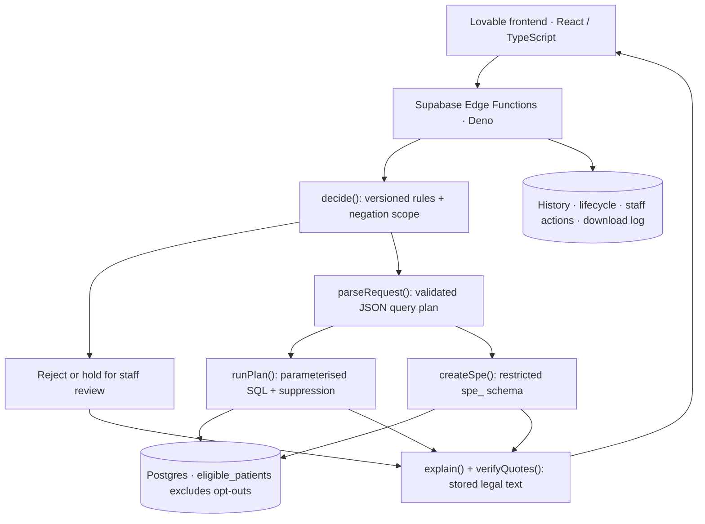

# EHDS Access Desk

**From a health-data request to a reasoned decision and a privacy-protected answer.**
A synthetic-data prototype for a Health Data Access Body (HDAB), covering Chapter IV
secondary use under [Regulation (EU) 2025/327](https://eur-lex.europa.eu/eli/reg/2025/327/oj/eng).
Built for the [EHDS Track 3 brief](https://github.com/AIM-Austria/TRACK-3-ehds/blob/main/README.md).

**Try it:** [live product](https://health-data-access-compass.lovable.app) →
[/desk](https://health-data-access-compass.lovable.app/desk): applicant guided form,
staff queue and demo, with German/English government-style design and role-based
views (applicant / staff / demo). The guided form has a live decision preview;
applicants see reasons, legal quotations, results, charts, an Austria region map
and decision letters downloadable as PDF. Accessibility work covers WCAG AA text
contrast and layouts at 360 px. Explore [/how-we-decide](https://health-data-access-compass.lovable.app/how-we-decide),
[/examples](https://health-data-access-compass.lovable.app/examples) and the anonymised
public [/register](https://health-data-access-compass.lovable.app/register).

**Demo video (≤2 minutes): TODO — team to insert recording link.**
The [recording script](docs/demo.md) covers what works and what does not.
The [backend repository](https://github.com/ErmisCho/clinical_hachathlon) is public;
the separate [frontend repository](https://github.com/ErmisCho/health-data-access-desk)
was private when checked on 2026-10-30.

## How it works



The synchronous pipeline checks purpose **before querying patient data**:
prohibited purposes are rejected (Art. 54); statistics are approved where sufficient
(Arts. 53/69, also 66 for a downgraded records application); justified record access
creates a prototype secure processing environment (SPE, Arts. 53/66/68/73).
Unclear purposes or unsupported definitions are held for staff review with no answer.
Staff can approve or override with a reason. `POST /requests/review` requires a
Supabase Auth user with `app_metadata.role = staff`; the audit log records the
authenticated user ID and email. Create accounts with `scripts/create-staff-user.ts`.

The rule-based parser accepts supported natural wording variants (#84) and turns
definitions into a validated query plan; only the engine generates SQL. Counts below 10 appear as `<10`, derived values as
`suppressed`, with secondary suppression against reconstructing hidden cells.
SPEs contain only the selected cohort and requested record types; browser roles
cannot read them. Explanations quote stored regulation paragraphs verbatim,
checked by `verifyQuotes`, with the applicable passage bolded in the UI.

The API exposes `POST /requests`, `POST /requests/preview` (no database work),
`POST /requests/review`, `GET /requests` (overview) and `GET /requests?id=…`.
`spe-download` blocks downloads with HTTP 403 and attempts to log each one;
`GET /register`, served by the public transparency register function, exposes only
an anonymised projection. Every valid decision response includes a three-month
decision deadline with its Art. 68(4) or 69(4) basis and quotation. Submission,
review and retrieval expose the lifecycle timeline. Postgres holds `patients`,
`conditions`, `medications`, `observations`, `encounters`, the opt-out-filtered
`eligible_patients` view, `request_log`, `request_event`, `staff_action`,
`spe_download_log` and per-request `spe_<id>` schemas.

**Models and services:** no LLM decides or computes. Decisions use deterministic
rules; answers use SQL. Services are Supabase (Postgres + Edge Functions;
deployment region `eu-west-1`), Lovable hosting and GitHub Actions CI.
The watsonx parser fallback (`supabase/functions/_shared/llm_fallback.ts`) and
reasoning memo (`supabase/functions/_shared/memo.ts`) are implemented, but disabled
unless all three credentials are set: `WATSONX_API_KEY`, `WATSONX_PROJECT_ID`,
`WATSONX_URL`. AI-assisted plans are always held for staff review; a memo is
returned for display only when every quotation verifies against stored legal
text. Neither feature sends patient data or database answers to the model.
Every pipeline response and saved decision carries `rule_id` and `rules_version`
from `decide()`. Rules version **1.0.2** includes P09 for credit scoring / loans
under Art. 54(1)(b). National rules per access body are configured in
`supabase/functions/_shared/hdab/hdab_configs.json`: Austria is the default, with
a Germany demo example for Art. 54(1)(e).
Federated comparison (#37) and in-SPE FHIR R4 conversion
(#38) exist as scripts, rather than UI workflows.

## Results — recorded 2026-10-30

Recorded measurements supplied for 2026-10-30 against the live deployment.
Reproduce them using the [evaluation commands](docs/running.md#evaluation).

| Check | Result |
|---|---|
| Ten supplied requests, HTTP `eval --target` | **10/10 decisions including articles** |
| Numeric answers (including SPE cohort size) | **6/6** |
| Privacy leaks detected | **0** |
| Consistency | **10/10 across 3 runs** |
| Slowest HTTP answer | **1.7 s** |
| Jury simulation: 57 unseen requests (42 earlier + 15 fresh naturally worded) | **0 wrong decisions, 0 wrong number sets, 0 leaks; 15 prohibited purposes rejected, 38 answered, 4 honestly held for review** |
| Federated vs central aggregates | **49/49 equal** |
| Stored legal paragraphs vs EUR-Lex | **42/42 verbatim** |

These are benchmark results, not proof of arbitrary-language coverage or production
compliance. Leak detection alone cannot prove source-level opt-out exclusion;
the shared eligible-patient view and query construction enforce it.

## Limits

Synthetic data only; no real HDAB integration. The parser is rule-based;
unusual or unsupported wording is held for staff review. AI features are off
without credentials. An isolated database schema is the prototype SPE, not a
complete research workspace. The hosted frontend still shows the "Edit with
Lovable" badge. The demo video link remains TODO.

## Run the backend

Prerequisites: Deno 2, Node.js/npm; Supabase CLI and your own project for database
work or deployment. From this repository root:

```sh
deno install
deno test -A
deno check supabase/functions/requests/index.ts supabase/functions/register/index.ts supabase/functions/spe-download/index.ts scripts/eval.ts scripts/jury-sim.ts scripts/federated-check.ts scripts/export-fhir.ts
```

Tests use local fixtures without a database. For loading the Track 3 data, running
local or HTTP evaluation, and deploying all three functions, follow
[setup and evaluation](docs/running.md). Keep credentials and CSVs out of Git.
Use `scripts/seed-demo.ts` to maintain curated demo data.
The frontend runs from its separate repository.

## Repository map

| Path | Purpose |
|---|---|
| `supabase/functions/requests/`, `supabase/functions/register/`, `supabase/functions/spe-download/` | Submission, review, public register and download block |
| `supabase/functions/_shared/` | Decision, parser, plan validation, SQL, SPE and explanations |
| `supabase/functions/_shared/rules/decision_rules.json` | Decision rules version 1.0.2 |
| `supabase/functions/_shared/hdab/hdab_configs.json` | Per-access-body configuration and national rule examples |
| `supabase/functions/_shared/llm_fallback.ts`, `supabase/functions/_shared/memo.ts` | Optional watsonx parser fallback and verified-quote memo |
| `supabase/functions/_shared/regulation/reg_2025_327.json` | Stored legal paragraphs |
| `supabase/migrations/` | Data schema, privacy boundaries and audit tables |
| `supabase/fixtures/` | Query plans and unseen/jury requests with reference SQL |
| `scripts/` | Loader, evaluator, jury simulation, federation and FHIR tools |
| `scripts/create-staff-user.ts`, `scripts/seed-demo.ts` | Staff account creation and curated demo data |
| `.github/workflows/ci.yml` | Tests, type checks and optional deployed evaluation |
| [docs/running.md](docs/running.md), [docs/api.md](docs/api.md), [docs/query-plan.md](docs/query-plan.md), [docs/fhir-mapping.md](docs/fhir-mapping.md) | Operations and implementation references |
